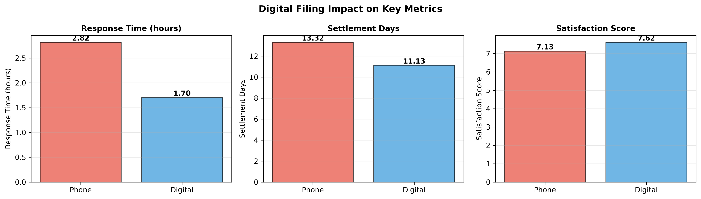
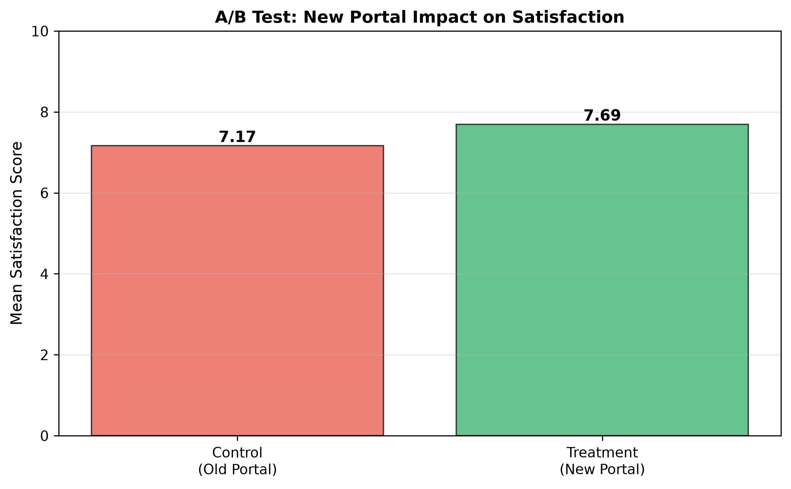
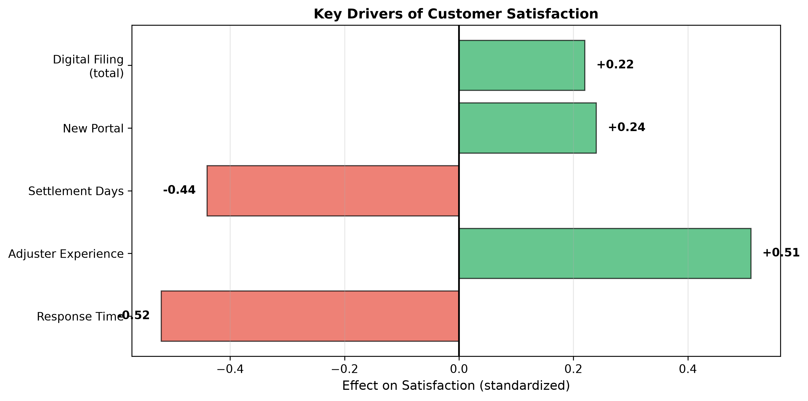
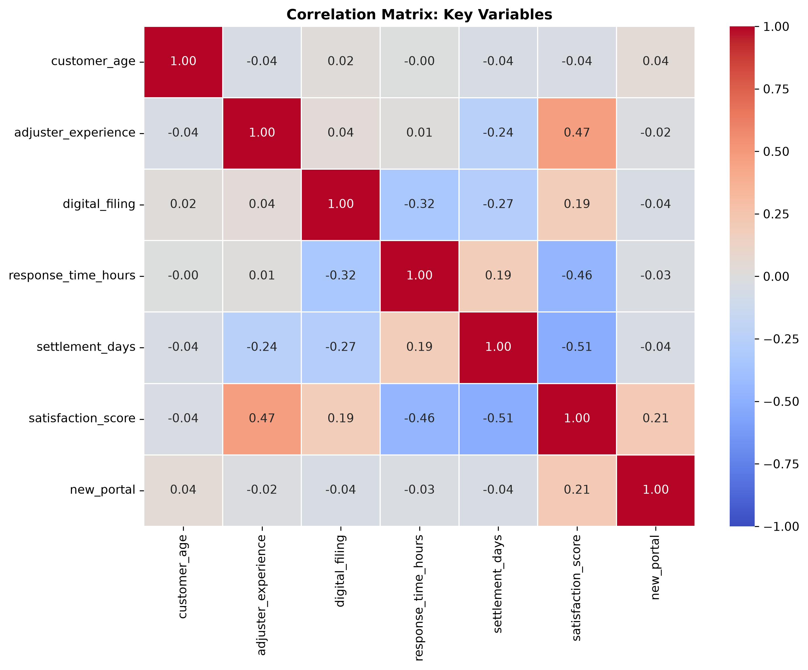

# Insurance Claims Analysis

End-to-end statistical analysis of 1,243 insurance claims to identify opportunities for improving operational efficiency and customer satisfaction.

## What I Did

Analyzed insurance claims data to answer four business questions:

1. What patterns exist in the data?
2. Does digital filing improve operational metrics?
3. Should we roll out the new claims portal?
4. What drives customer satisfaction?

## Key Findings

### Digital Filing Delivers Better Outcomes



Digital filing improves response time by **37%**, settlement time by **~2 days**, and satisfaction by **0.3-0.6 points** compared to phone filing.

### New Portal A/B Test: Clear Win



The new portal increased satisfaction by **+0.53 points** (95% CI: 0.39-0.67), a **7.3% improvement**. This supports full rollout.

### Response Time is the Strongest Satisfaction Driver



Response time has the largest impact on satisfaction, followed by adjuster experience and settlement speed.

## Files

```
├── analysis.ipynb           # Main analysis with all code and findings
├── executive_summary.md     # Non-technical summary for stakeholders
├── claims_data.csv         # Dataset (1,243 claims)
├── images/                 # Visualizations
└── README.md               # This file
```

## Tech Stack

- **Python:** pandas, scipy, statsmodels, pingouin
- **SQL:** DuckDB for aggregations
- **Visualization:** matplotlib, seaborn
- **Analysis:** Jupyter Notebook

## Methodology

### 1. Exploratory Data Analysis



Distribution analysis, summary stats, and correlation heatmap to identify relationships between variables.

### 2. Hypothesis Testing

- Welch's t-tests for satisfaction and settlement days
- Mann-Whitney U test for response time (right-skewed data)
- Calculated effect sizes and 95% confidence intervals

### 3. A/B Test Evaluation

Compared treatment (n=605) vs. control (n=638) groups using t-tests with secondary Mann-Whitney validation.

### 4. Regression Analysis

Built two models:
- **Model 1:** Full model to identify direct effects
- **Model 2:** Reduced model to capture total effect of digital filing

Validated assumptions with VIF checks, residual plots, and Q-Q plots.

## Results Summary

**Digital Filing Impact:**

| Metric | Digital | Phone | Difference | Effect Size |
|--------|---------|-------|------------|-------------|
| Response time (median) | Lower | Higher | -37% | RBC = -0.36 |
| Settlement days | Lower | Higher | -2.20 days | Cohen's d = 0.57 |
| Satisfaction | 7.90 | 7.42 | +0.48 points | Cohen's d = 0.38 |

**A/B Test:**
- Control: 7.17 (95% CI: 7.07-7.27)
- Treatment: 7.69 (95% CI: 7.60-7.79)
- Lift: +0.53 points (+7.3%)

**Regression Model:**
- R² = 0.58 (explains 58% of satisfaction variance)
- Top drivers: response time (-0.52), adjuster experience (+0.51), settlement days (-0.44)

## Recommendations

1. **Roll out the new portal** - Clear positive impact
2. **Reduce response time** - Largest satisfaction driver
3. **Reduce settlement days** - Second priority
4. **Promote digital filing** - Improves all metrics
5. **Invest in adjuster experience** - Training and retention

Full details: [executive_summary.md](executive_summary.md)

## How to Run

```bash
# Clone repo
git clone https://github.com/jscode-1302/insurance-claims-optimization.git
cd insurance-claims-optimization

# Install dependencies
pip install pandas duckdb matplotlib seaborn scipy pingouin statsmodels jupyter

# Run notebook
jupyter notebook analysis.ipynb
```

## Skills Demonstrated

- Exploratory data analysis
- Hypothesis testing (t-tests, Mann-Whitney U)
- A/B testing and experiment evaluation
- Multiple regression modeling
- Statistical assumption validation
- Data visualization
- SQL for data aggregation
- Business communication

---

**Portfolio project demonstrating end-to-end data analysis skills.**

**Contact:** [jeansalazar135@gmail.com](mailto:jeansalazar135@gmail.com)
